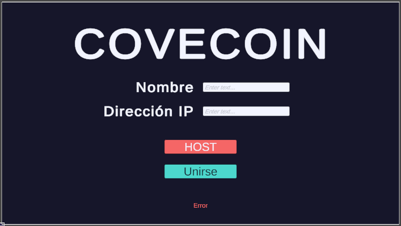
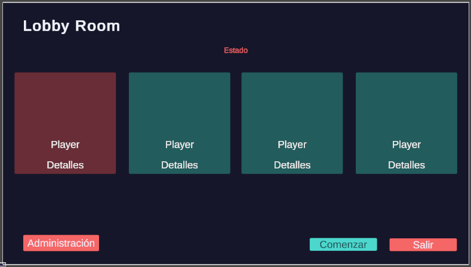
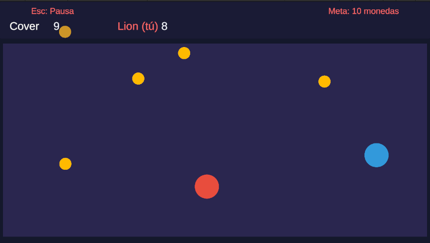
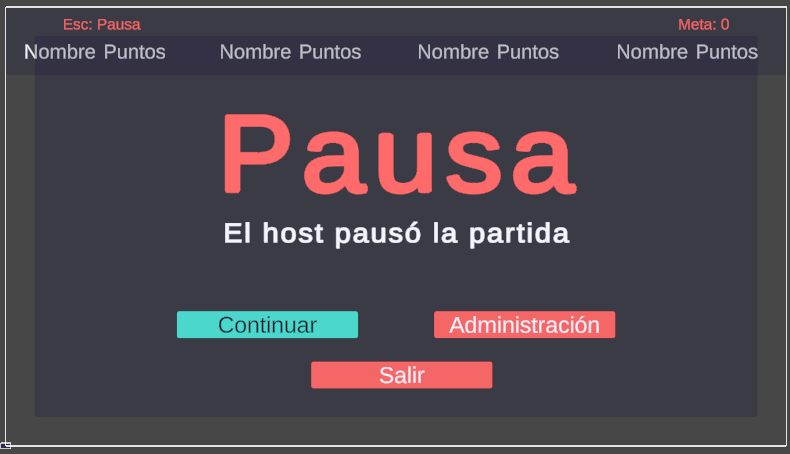
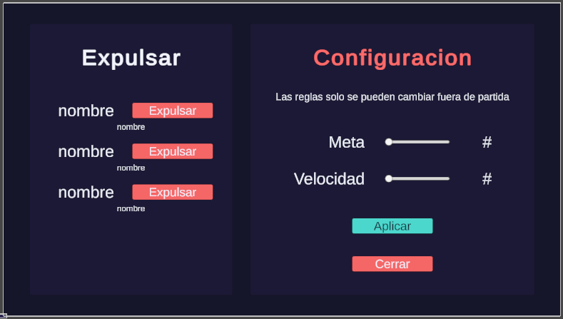
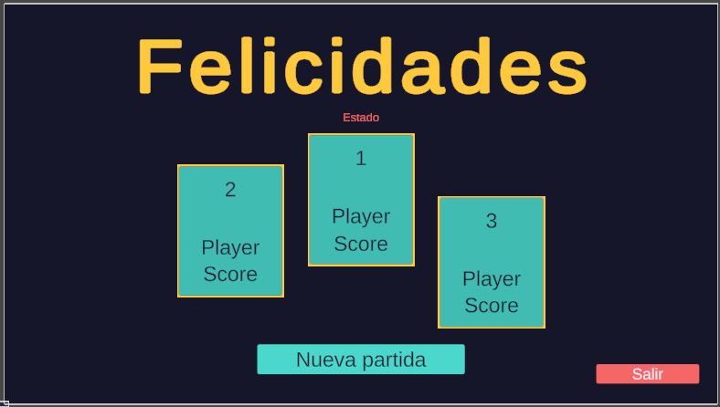

# COVECOIN

Juego multijugador de recolección de monedas con arquitectura **Player Host** en Unity. Un jugador actúa como host (servidor y cliente a la vez) y los demás se conectan directamente a su instancia por TCP. No hay servidor dedicado.

Proyecto de Servicios Multimedia. Autora: Angela Ramos.

## Descripción del juego

Los jugadores se mueven por una arena y recogen monedas. El primero en llegar a la meta de monedas gana la partida. Cada jugador tiene un color distinto, y el host puede iniciar una nueva partida sin que nadie tenga que reconectarse.

- **Objetivo:** llegar primero a la meta de monedas (10 por defecto, configurable por el host).
- **Jugadores:** de 2 a 4 (host incluido).
- **Controles:** WASD o flechas para moverse. El host usa Esc para pausar y reanudar.

## Requisitos técnicos

- Unity **2022.3.46f1** (URP 2D).
- Windows 10 u 11.
- Paquete TextMeshPro (incluido en el proyecto).
- Los jugadores deben alcanzar la IP del host por red. Se usa el puerto **TCP 7777**. En la misma red local basta con permitir el aviso del firewall de Windows; por internet, el host debe abrir ese puerto en su router.

## Cómo ejecutar

### Opción A: dos o tres instancias en un solo computador (pruebas)

1. Abre el proyecto con Unity 2022.3.46f1 y genera un build (File > Build Settings > Build).
2. Ejecuta el build dos veces, o una vez y la segunda desde el Editor en Play.
3. Si Windows muestra el aviso del firewall, permite el acceso en redes privadas.

### Host

1. En el menú, escribe tu nombre y presiona **HOST**.
2. Entras al lobby. Cuando haya jugadores, presiona **Comenzar**.
3. Si otros jugadores deben conectarse desde otro computador, compárteles tu dirección IP local (por ejemplo la que muestra `ipconfig`).

### Clientes

1. En el menú, escribe tu nombre y la dirección IP del host (`127.0.0.1` si es el mismo computador).
2. Presiona **Unirse**. Entras al lobby y esperas a que el host inicie.

Si algo falla (sala llena, nombre repetido, host no encontrado, expulsión), el menú muestra el motivo.

## Funcionalidades implementadas

### Red y conexiones
- Arquitectura Player Host sobre **TCP**: el host escucha, acepta clientes y también juega.
- Conexión y desconexión de jugadores en plena partida sin reiniciar el juego ni afectar a los demás.
- Detección de caídas: por cierre del socket y por tiempo de inactividad (8 s sin respuesta).
- Validación de nombres (longitud, caracteres, duplicados) y límite de jugadores.
- Un jugador que entra a mitad de partida recibe el estado actual (monedas, puntajes y reglas).

### Funciones de administración del host (4 de 5)
- **Expulsar (kick)** a cualquier jugador desde el panel de administración.
- **Ver el ping** de cada jugador, medido cada segundo (lobby y panel de administración).
- **Pausar** la partida para todos, con indicador visible.
- **Modificar reglas**: meta de monedas y velocidad de los jugadores (solo fuera de partida).

### Flujo de juego
Menú, lobby, partida, pantalla de resultados con podio y nueva partida sin volver a conectar.

### Sincronización
- Los clientes envían su input y el host calcula las posiciones de todos.
- El host envía el estado de todos los jugadores 20 veces por segundo.
- Cada cliente aplica **interpolación**: dibuja a los jugadores 0,1 s en el pasado, mezclando linealmente entre los dos estados recibidos que rodean ese instante. Así el movimiento se ve continuo aunque lleguen 20 actualizaciones por segundo.

## Arquitectura

```
Cliente A ----\
Cliente B -----+--> TCP 7777 --> HOST (jugador + servidor)
              /                   - acepta y valida conexiones
Host (local) -                    - simula movimiento y monedas
                                  - difunde estado a los clientes
```

- **Protocolo:** mensajes con prefijo de longitud de 4 bytes y un texto con campos separados por `|`. Se limita el tamaño y se valida cada mensaje recibido. Se desactiva el algoritmo de Nagle (`NoDelay`) para reducir la latencia.
- **Gestión de red:** cada conexión usa un canal (`TcpMessageChannel`) con un hilo de lectura que deja los mensajes en una cola concurrente. `NetworkSession` los procesa en el hilo principal de Unity, una vez por frame.
- **Por qué TCP:** entrega ordenada y confiable, detección sencilla de desconexiones y menos código de red propio. La contrapartida es que una pérdida de paquetes puede producir retrasos, que se compensan con la interpolación.
- **Host autoritativo:** solo el host decide posiciones, recogida de monedas, puntajes y fin de partida.
- **Modelo de partida:** un único `MatchModel` guarda el estado, los puntajes, las monedas, la pausa y las reglas. Host y clientes lo modifican con los mismos métodos, y la interfaz reacciona a sus eventos.

### Estructura de scripts

```
Assets/Scripts/
  Networking/   sockets, canal de mensajes, host, cliente, sesión, protocolo
  Gameplay/     avatares, movimiento, interpolación, monedas, partida, reglas, admin
  UI/           vistas de menú, lobby, HUD, pausa, administración y resultados
```

## Errores y limitaciones conocidos

- **Sin predicción en el cliente:** el avatar propio de un cliente también se ve con unos 0,1 s de retraso respecto a sus teclas. El del host responde al instante.
- **Sin extrapolación:** si un estado se retrasa más de lo normal, el avatar se queda quieto hasta que llega el siguiente.
- **Posiciones de aparición:** se reparten por número de jugador, y dos jugadores pueden aparecer superpuestos si entran y salen varias veces.
- **Las reglas** solo se pueden cambiar fuera de partida, a propósito.
- Un jugador expulsado puede volver a entrar (no hay lista de bloqueo de IP).
- Los jugadores no colisionan entre sí.
- Solo se ha probado en Windows y con hasta 3 jugadores a la vez en la misma red.
- Si el host cierra el juego, los clientes vuelven al menú; la partida no continúa.

## Capturas de pantalla

| Menú | Lobby | Partida |
|---|---|---|
|  |  |  |

| Pausa | Administración | Resultados |
|---|---|---|
|  |  |  |
